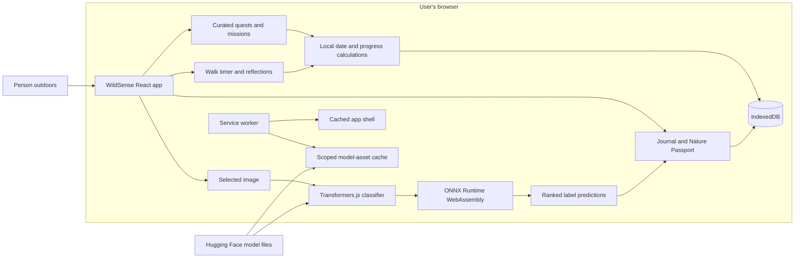
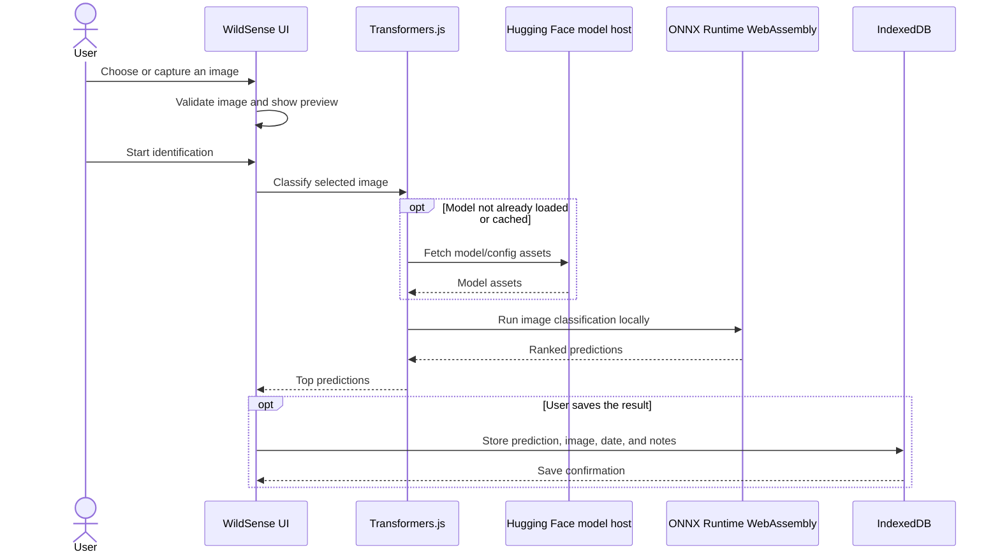
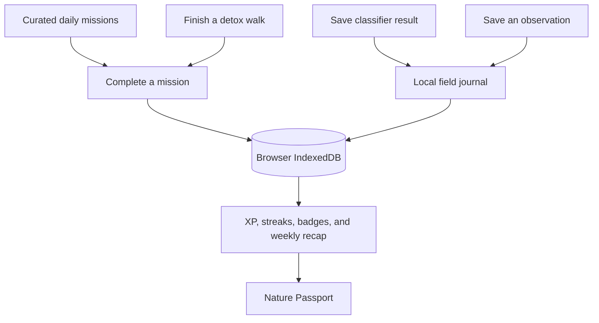
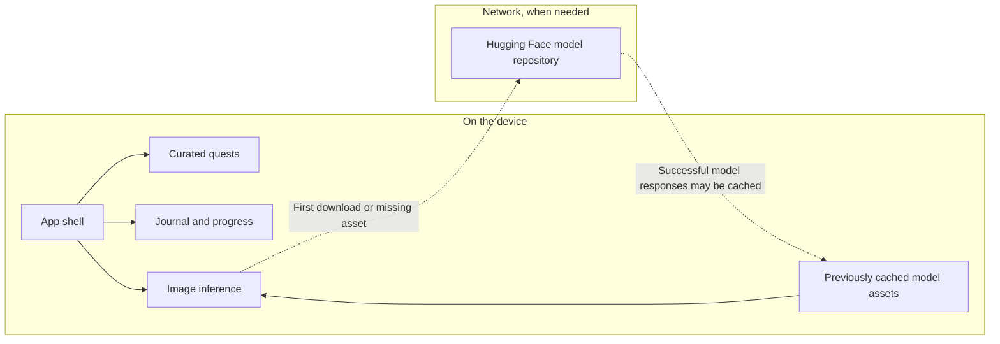

# 🌿 WildSense: An Offline AI Nature Companion

*This is a submission for the [Hacktoberfest Open-Source AI Challenge Week 1: Touch Grass](https://dev.to/challenges/hacktoberfest-week1-2026-10-05).*

## What I Built

WildSense is a private, mobile-friendly companion for noticing more on everyday walks. It pairs small, locally curated nature quests with an optional in-browser image classifier and a field journal that stays on the user's device.

The idea is to make technology a gentle nudge toward the outdoors—not another reason to stay on a screen. A person can follow a short prompt, take a digital-detox walk, record an observation, or use a photo to explore what they saw.

The quests do not depend on AI or an internet connection. They are written to be approachable in ordinary places such as a garden, park, forest, or lakeside, and encourage observing without disturbing living things.

## Screenshots

These are captures of the running application. The filenames are retained from the original screenshots.

### Home and daily nature prompt

### Short nature quests

### Choose a photo for on-device identification

### Image-classifier results

## Built for Real-World Walks

WildSense includes:

- A rotating daily nature quest and a collection of short, optional activities.
- **Touch Grass Mode:** ten curated missions with simple instructions, a closer-look prompt, and an optional field note.
- **Digital Detox Walks:** 5-, 10-, and 20-minute timers with pause/resume and an optional reflection after completion.
- **Nature Passport:** locally calculated activity totals, milestones, streaks, and a chronological record of discoveries.
- **Weekly Nature Wrapped:** a recap calculated from activity saved during the current local calendar week.
- **Identify:** a user-selected photo is classified in the browser, with the top predictions available to save in the journal.

The app avoids accounts, location permissions, analytics, and hosted inference. A first-time image-model download does require an internet connection; the curated quests and previously saved local records do not.

## Demo and Code

- **Run locally:** follow the setup instructions in [README.md](./README.md), then run `npm run dev`.
- **GitHub repository:** [github.com/Vrushali1977/WildSense](https://github.com/Vrushali1977/WildSense)

There is no hosted demo URL included here. The project is a client-side React application with no application backend.

## How I Built It

### Technology

- **UI:** React, TypeScript, and Vite.
- **Image classification:** Transformers.js with `Xenova/vit-base-patch16-224`, using ONNX Runtime WebAssembly and 8-bit quantized weights.
- **Local persistence:** IndexedDB for journal entries, selected image blobs, quest progress, mission rewards, and completed walks.
- **Install/offline support:** a Vite PWA service worker precaches the app shell and uses a narrowly scoped runtime cache for successful model-file responses.
- **Tests:** Vitest tests for classifier response handling, IndexedDB operations, quests, and gamification calculations.

There is no generative-AI quest pipeline or backend. Quest and mission content is curated in the app; deterministic client-side code rotates daily prompts and calculates progress. The AI feature is a general image classifier, not a nature-specific species identifier.

### System Architecture

The selected photo and inference stay in the browser. On the first identification, the browser downloads the model assets from Hugging Face; successful model responses may be cached by the service worker. The app does not send the photo to a hosted inference API.

### Image-Identification Flow

Predictions are ranked matches from a general ImageNet classifier. Their scores are not verified species identities or calibrated certainty; important observations should be checked against reliable references.

### Local Activity and Storage

Rewards and recaps are calculated from local records. Mission rewards are keyed to the local date, and walk rewards are recorded only after a timer completes. The data is not synchronized to a server and may be removed if browser storage is cleared or evicted.

### Offline and Privacy Boundaries

Quest content and saved records are local. A first model download needs a connection, and future offline inference depends on the browser retaining the required cached files. Offline model availability is not guaranteed.

## Safety and Limitations

- Missions invite observation without picking plants, disturbing wildlife, or leaving safe paths.
- No location permission is needed; environments are selected manually when relevant.
- The classifier is general-purpose and may return misleading labels, especially for local species. Its output is exploratory, not expert identification.
- Model assets can be large, and inference depends on browser support, available memory, and storage quotas.
- Clearing browser data may remove the journal, progress, and cached model files.

## Why Open Innovation Matters

WildSense uses a browser-compatible model and open web tooling to make experimentation inspectable and keep inference on the user's device. It also keeps the core outdoor experience independent of the model: the curated prompts, walk timer, journal, and progress calculations continue to work without AI.

That separation is intentional. AI can offer a starting point for curiosity, while transparent limitations and local-first design keep it from being treated as an authority—or a requirement—for spending time outside.

---

WildSense is an invitation to put the phone away for a little while, notice one small thing, and keep only the memory you choose to record.

🌱 **Notice more. Scroll a little less.**
