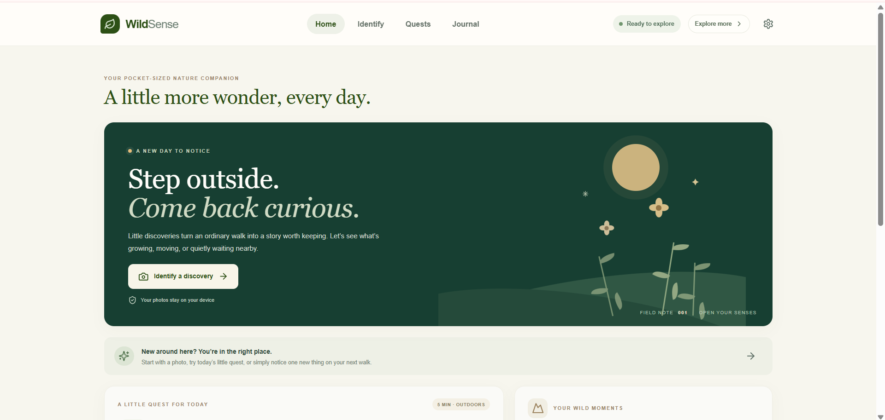
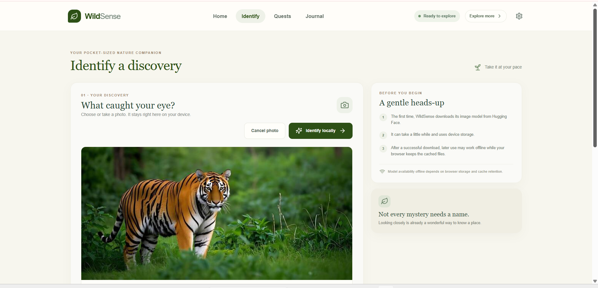
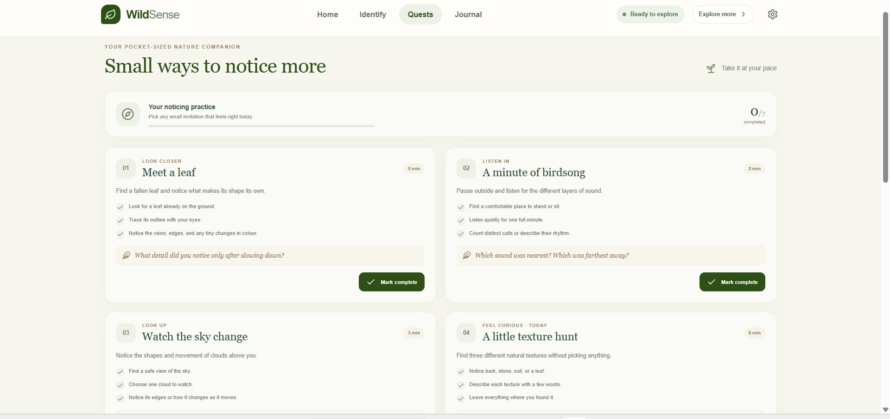
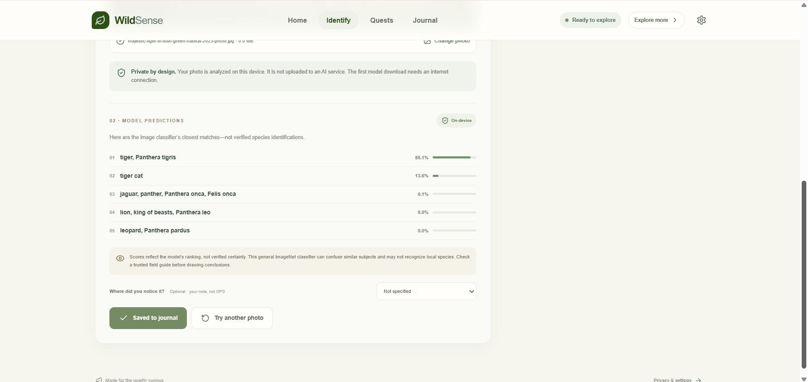

# WildSense — Offline AI Nature Companion

WildSense is a mobile-first nature companion for curious walks: a private, in-browser image-classification flow, small outdoor quests, and a local field journal. The interface and quests are designed to remain useful before any model has been downloaded.

## Features

- **Notice:** a daily nature quest and a collection of optional, achievable outdoor prompts.
- **Touch Grass Mode:** ten locally curated daily nature missions with instructions, optional Look Closer notes, and one reward per mission instance per local day.
- **Grow:** XP, current exploration streaks, and five earned/unlocked milestone badges calculated from recorded activity.
- **Nature Passport:** recorded discovery/mission totals, earned badges, curated nature categories, manually selected environments, and a chronological local timeline.
- **Walk gently:** 5-, 10-, and 20-minute Digital Detox Walk timers with pause/resume, an explicit early-end path, and optional saved reflections.
- **Look back:** a weekly Nature Wrapped recap calculated from local calendar-week activity only.
- **Identify:** choose or capture a supported image, preview it, and run a general image classifier in the browser.
- **Keep:** save model predictions, image blobs, dates, and notes to local IndexedDB.
- **Explore privately:** no account, location permission, analytics, tracking, or hosted inference fallback.
- **Install:** a web app manifest, installable icon, service-worker app-shell precache, and a limited model-file runtime cache.

## Screenshots

Screenshots of the running app:






## Prerequisites

- Node.js 20 or later (npm is included).
- A modern browser with JavaScript modules, WebAssembly, and IndexedDB support.
- An internet connection for package installation and for the model's first download.

## Setup and commands

Install dependencies using the generated npm lockfile:

```sh
npm ci
```

Run the development server:

```sh
npm run dev
```

Run checks:

```sh
npm run typecheck
npm run lint
npm test
npm run build
```

Preview a production build:

```sh
npm run preview
```

The development server uses Vite's printed local URL (normally `http://localhost:5173`). Use the exact URL printed by your environment.

## Architecture

- `src/App.tsx` — responsive home, identify/results, existing quests, journal, settings, secondary navigation, and local write flows.
- `src/components/Exploration.tsx` — Touch Grass missions, Nature Passport, Digital Detox Walk, and weekly recap screens.
- `src/lib/classifier.ts` — lazy Transformers.js initialization, progress handoff, model singleton, and prediction validation.
- `src/lib/db.ts` — IndexedDB version 2; preserves the version-1 journal/quest stores and adds mission-completion and completed-walk stores with duplicate-safe reward writes.
- `src/lib/gamification.ts` — local-date mission rotation, XP/badge/streak calculations, and local-week recap aggregation.
- `src/lib/walkTimer.ts` — deterministic deadline/pause/resume math for the walk countdown.
- `src/data/quests.ts` — local quest content, daily quest selection, and progress counting.
- `src/data/missions.ts` — offline curated missions, observation prompts, and manual environment options.
- `src/styles.css` and `src/styles-exploration.css` — responsive, reduced-motion-aware design system and exploration screens.
- `vite.config.ts` — PWA manifest, app-shell precaching, and narrowly scoped successful-model-response caching.
- `tests/` — model-output handling, quest calculations, and IndexedDB operation tests.

## Image model and attribution

The app requests **`Xenova/vit-base-patch16-224`** from [Hugging Face](https://huggingface.co/Xenova/vit-base-patch16-224) when the user starts identification. Its model card documents Transformers.js image-classification use and identifies `google/vit-base-patch16-224` as its base model; the repository contains ONNX files and configuration for browser-compatible inference. The app selects the repository's 8-bit quantized `onnx/model_quantized.onnx` file (listed upstream at about 88 MB), not the 347 MB full-precision file; configs and runtime assets are additional downloads.

The upstream Google model card declares **Apache-2.0**. The Xenova conversion repository's current model-card/API metadata does **not** declare a license field, so the converted artifact's licensing is not independently confirmed here. This project does not bundle model binaries. Review the source repository and upstream notices before redistribution or commercial deployment; no broader licensing claim is made.

The source model is a Vision Transformer fine-tuned on ImageNet's 1,000 general image classes. It is **not a specialist nature or species-identification model**. Labels and scores shown in results are the model's raw ranked predictions. They are not verified identities, species records, or calibrated certainty. Confirm important observations with reliable references.

## Privacy and local storage

- Selected images are passed to Transformers.js in the browser; no photo upload or remote inference API is implemented.
- The model library and ONNX files are fetched from Hugging Face only after the user begins identification. Those initial model requests require internet access and disclose ordinary network metadata to the model host.
- The app does not include analytics, tracking, or location/camera permission requests. Camera capture is offered only through a user-initiated file input.
- Journal records, image blobs, legacy quest completion, mission completion/XP, and completed walk rewards are stored in this browser's IndexedDB. New records are not synchronized or backed up. Clearing site data, browser eviction, or uninstalling browser data may remove them.
- Mission rewards are 10 XP per mission instance, keyed to the user's local calendar date; completed walks earn 15 XP only after the selected timer reaches zero and the record is stored. Duplicate writes do not award again. Current streaks use local calendar dates and stop at a missed day.
- The version-2 schema adds stores without replacing or clearing the existing journal or legacy quest stores. New optional journal fields do not require a destructive migration.
- The Settings screen provides an explicit confirmation before clearing WildSense journal entries and quest progress.

## Offline behavior

The service worker precaches the production app shell and static assets. Quests and previously stored journal data do not require network access. A scoped Workbox cache stores only successful `200` responses from the selected model repository's `/resolve/main/` assets (up to 32 entries, subject to browser storage quotas and eviction). The browser/OS can still remove cached data; offline access to a model is not guaranteed. A first-time model download requires a connection. Development-server caching differs from a production service-worker install.

For a practical offline check, serve a production build over localhost/HTTPS, open the app once, wait for service-worker installation, and reload. For model offline use, first complete a successful identification, then disconnect and retry/reload. Browser DevTools' Network > Offline can simulate loss of connectivity. Verify the model actually works after reconnecting and disconnecting; cache presence alone does not prove an offline inference succeeds.

## Verification and known limitations

- Automated checks should be run from the commands above; their outcomes are not inferred from this documentation.
- Manual browser checks are needed for refreshing after new mission/walk/observation writes, real-photo inference on target devices, cold/offline model cache behavior, browser eviction, and screen-reader/device testing.
- Model files may be large. Browser storage, available memory, WebAssembly support, and model-host availability vary by device.
- The converted repository does not state its own license in the metadata observed during implementation; see the licensing caveat above.

## Contributing

Keep changes local-first, preserve the honest distinction between model predictions and verified facts, and add tests for persistence or classifier changes. Do not introduce telemetry, photo uploads, or unrequested permissions. Run type checking, linting, tests, and the production build before submitting changes.
